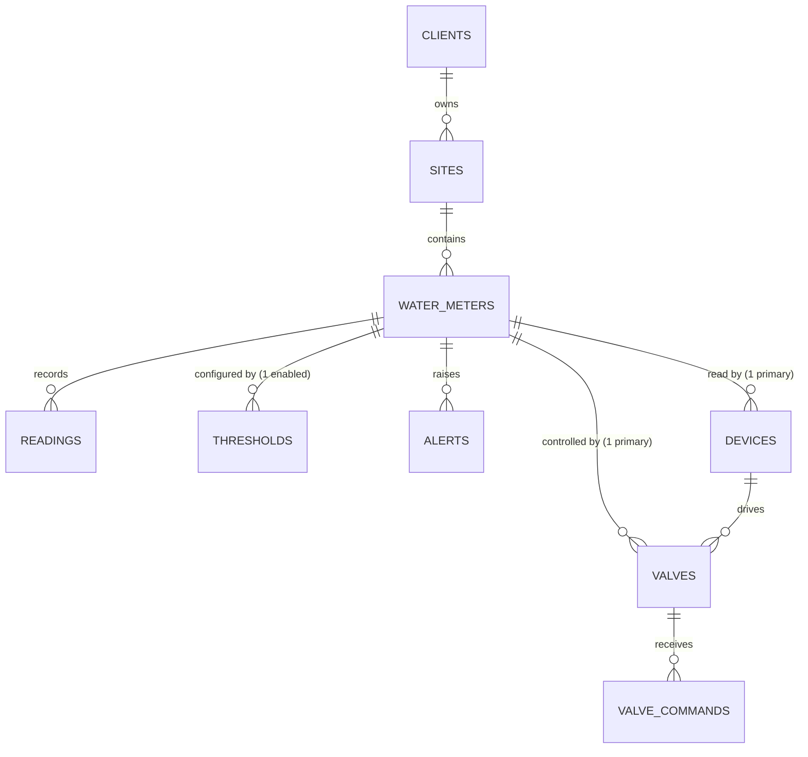

# WaterWatch - Database documentation

SQLite database, 9 tables. Software proof of concept (virtual ESP32, simulated valve), designed so real hardware can replace the simulation without changing the schema.

## 1. Files

| File | Purpose |
|---|---|
| `schema.sql` | All tables, constraints, indexes, `updated_at` triggers |
| `database.py` | Connection module (`get_connection`) + two transactional helpers |
| `init_db.py` | Creates the database (`--sample` loads demo data, `--reset` starts clean) |
| `sample_data.sql` | Demo data: 1 hotel, 1 site, 2 meters, 2 days of readings, 4 alerts, 1 virtual ESP32, 1 valve, 6 commands |
| `queries.sql` | The 7 requested example queries + write examples |
| `erd.mermaid` | Entity Relationship Diagram (also below) |

Quick start:

```bash
python init_db.py --reset --sample
```

## 2. Architecture

`water_meters` is the hub: everything measured, detected or controlled hangs off a meter.

```
clients -> sites -> water_meters -+-> readings
                                  +-> thresholds
                                  +-> alerts
                                  +-> devices --+
                                  +-> valves <--+  (device and valve belong to the same meter)
                                         |
                                         +-> valve_commands
```

### ERD



(The full diagram with all columns is in `erd.mermaid`.)

### Relationships

| Relationship | Cardinality | Enforced by |
|---|---|---|
| clients -> sites | 1 to many | FK `sites.client_id` |
| sites -> water_meters | 1 to many | FK `water_meters.site_id` |
| water_meters -> readings | 1 to many | FK `readings.meter_id`, `UNIQUE(meter_id, timestamp)` |
| water_meters -> thresholds | 1 to 1 *enabled* (old versions may be kept disabled) | FK + partial unique index `WHERE enabled = 1` |
| water_meters -> alerts | 1 to many | FK `alerts.meter_id` |
| water_meters -> devices | 1 to 1 *primary* (more allowed later) | FK + partial unique index `WHERE is_primary = 1` |
| water_meters -> valves | 1 to 1 *primary* (more allowed later) | FK + partial unique index `WHERE is_primary = 1` |
| devices -> valves | 1 to many | composite FK `(device_id, meter_id) -> devices(id, meter_id)` |
| valves -> valve_commands | 1 to many | FK `valve_commands.valve_id` |

### Key design decisions

1. **Confirmed vs requested valve state.** `valves.valve_status` is only ever the last *confirmed* state. The requested state is the latest row in `valve_commands` (derived, not stored, so there is no redundancy). A `CLOSE` command never turns a valve `CLOSED`; only an ESP32 confirmation does (`confirm_valve_command()` in `database.py` updates both tables in one transaction).
2. **Command lifecycle is enforced by CHECK constraints**: `PENDING` = not sent; `SENT` and `CONFIRMED` need `sent_at`; `executed_at` is set if and only if the status is `CONFIRMED`; `FAILED` needs an error message; timestamps must be in order.
3. **Valve, device and meter cannot contradict each other**: the composite foreign key makes it impossible to attach a valve to a device of another meter.
4. **"One per meter" is enforced with partial unique indexes** (and the `is_primary` columns I added to `devices` and `valves`), not with a blanket `UNIQUE(meter_id)`. Later you can add a second device or replace a virtual ESP32 by a real one (new row, flip the primary flag) without redesigning anything.
5. **History is never lost**: every FK is `ON DELETE RESTRICT`. Deactivate with `status` / `enabled` instead of deleting.
6. **Timestamps** are ISO 8601 UTC text (`2026-11-26T14:00:00Z`), validated by a GLOB CHECK. They sort correctly as text. `updated_at` is maintained by triggers.
7. **Not stored on purpose** (derivable): daily consumption, requested valve state, lost volume of a day.

## 3. Tables and fields

Types are SQLite types. "Req." = `NOT NULL`. Every table also has `id INTEGER PRIMARY KEY AUTOINCREMENT`.

### 3.1 `clients` - customers using WaterWatch

| Field | Type | Req. | Constraints / default | Description |
|---|---|---|---|---|
| name | TEXT | yes | not blank | Customer or organization name |
| client_type | TEXT | yes | `HOTEL`, `WORKSHOP`, `FARM` | Customer category |
| contact_name | TEXT | no | | Main contact person |
| contact_email | TEXT | no | basic format check | Contact email |
| contact_phone | TEXT | no | | Contact phone |
| created_at | TEXT | yes | default now (UTC) | Registration date |
| updated_at | TEXT | yes | default now, trigger | Last modification |

### 3.2 `sites` - physical locations of a client

| Field | Type | Req. | Constraints / default | Description |
|---|---|---|---|---|
| client_id | INTEGER | yes | FK -> clients(id) | Owner |
| name | TEXT | yes | not blank, `UNIQUE(client_id, name)` | Site name |
| address | TEXT | no | | Address |
| description | TEXT | no | | Free description |
| created_at / updated_at | TEXT | yes | default now, trigger | Audit |

### 3.3 `water_meters` - meters installed on a site

| Field | Type | Req. | Constraints / default | Description |
|---|---|---|---|---|
| site_id | INTEGER | yes | FK -> sites(id) | Site where it is installed |
| meter_name | TEXT | yes | not blank, `UNIQUE(site_id, meter_name)` | Human name |
| meter_code | TEXT | yes | `UNIQUE` | Meter identification code |
| location_description | TEXT | no | | Where it is installed |
| status | TEXT | yes | `ACTIVE` / `INACTIVE`, default `ACTIVE` | Operating status |
| installation_date | TEXT | no | `YYYY-MM-DD` | Installation date |
| created_at / updated_at | TEXT | yes | default now, trigger | Audit |

### 3.4 `readings` - consumption time series (most important table)

| Field | Type | Req. | Constraints / default | Description |
|---|---|---|---|---|
| meter_id | INTEGER | yes | FK -> water_meters(id) | Measured meter |
| timestamp | TEXT | yes | ISO 8601 UTC, `UNIQUE(meter_id, timestamp)` | Measurement time |
| flow_rate | REAL | yes | `>= 0` | **Instantaneous** flow, L/min |
| total_volume | REAL | yes | `>= 0` | **Cumulative** volume, liters |
| source | TEXT | yes | `SIMULATION` / `DEVICE`, default `SIMULATION` | Where the reading comes from |
| created_at | TEXT | yes | default now | Insertion time |

The unique constraint also provides the index `(meter_id, timestamp)` used by history, chart and daily queries. For bulk inserts from a simulator, use `INSERT OR IGNORE` to skip duplicates.

### 3.5 `thresholds` - detection limits

| Field | Type | Req. | Constraints / default | Description |
|---|---|---|---|---|
| meter_id | INTEGER | yes | FK -> water_meters(id); one row with `enabled = 1` per meter | Meter concerned |
| max_flow_rate | REAL | yes | `> 0` | Max acceptable flow, L/min |
| max_daily_volume | REAL | yes | `> 0` | Max acceptable daily volume, liters |
| continuous_flow_duration | INTEGER | yes | `> 0` | Max acceptable continuous-flow duration, minutes |
| enabled | INTEGER | yes | 0 / 1, default 1 | Whether this configuration is active |
| created_at / updated_at | TEXT | yes | default now, trigger | Audit |

### 3.6 `alerts` - detected anomalies (history preserved)

| Field | Type | Req. | Constraints / default | Description |
|---|---|---|---|---|
| meter_id | INTEGER | yes | FK -> water_meters(id) | Meter concerned |
| alert_type | TEXT | yes | `LEAK`, `HIGH_CONSUMPTION`, `FLOW_SPIKE`, `CONTINUOUS_FLOW` | Kind of anomaly |
| severity | TEXT | yes | `LOW`, `MEDIUM`, `HIGH`, `CRITICAL` | Gravity |
| description | TEXT | yes | | Explanation shown in the (simulated) notification |
| detected_at | TEXT | yes | ISO 8601 UTC | Detection time |
| estimated_lost_volume | REAL | no | `>= 0` or NULL | Estimated lost liters, when computable |
| status | TEXT | yes | `NEW`, `ACKNOWLEDGED`, `RESOLVED`, `FALSE_POSITIVE`; default `NEW` | Processing state |
| resolved_at | TEXT | no | set **exactly when** status is `RESOLVED` or `FALSE_POSITIVE`; `>= detected_at` | Closing time |
| created_at / updated_at | TEXT | yes | default now, trigger | Audit (`updated_at` added by me: status changes) |

### 3.7 `devices` - ESP32 devices (virtual now, real later)

| Field | Type | Req. | Constraints / default | Description |
|---|---|---|---|---|
| meter_id | INTEGER | yes | FK -> water_meters(id) | Meter the device reads |
| device_uid | TEXT | yes | `UNIQUE` | Unique device identifier |
| device_name | TEXT | yes | not blank | Display name |
| device_type | TEXT | yes | `ESP32` / `VIRTUAL_ESP32`, default `VIRTUAL_ESP32` | Real or simulated |
| connection_status | TEXT | yes | `ONLINE` / `OFFLINE`, default `OFFLINE` | Connection flag |
| last_seen | TEXT | no | ISO 8601 UTC | Last communication |
| is_primary | INTEGER | yes | 0 / 1, default 1; one primary per meter | Primary device of the meter |
| created_at / updated_at | TEXT | yes | default now, trigger | Audit |

`UNIQUE(id, meter_id)` exists only to be the target of the composite FK from `valves`. `connection_status` is a convenience flag; `last_seen` is the source of truth (the app should flip a silent device to `OFFLINE`).

### 3.8 `valves` - controlled valves

| Field | Type | Req. | Constraints / default | Description |
|---|---|---|---|---|
| meter_id | INTEGER | yes | part of composite FK | Meter the valve is on |
| device_id | INTEGER | yes | composite FK `(device_id, meter_id)` -> devices | Controlling device (same meter) |
| valve_name | TEXT | yes | not blank, `UNIQUE(meter_id, valve_name)` | Display name |
| valve_status | TEXT | yes | `OPEN` / `CLOSED` / `UNKNOWN`, default `UNKNOWN` | **Last confirmed** state |
| control_mode | TEXT | yes | `MANUAL` / `AUTOMATIC`, default `MANUAL` | `AUTOMATIC` = automatic shut-off enabled |
| last_status_update | TEXT | no | required whenever status is not `UNKNOWN` | When the state was confirmed |
| is_primary | INTEGER | yes | 0 / 1, default 1; one primary per meter | Primary valve of the meter |
| created_at / updated_at | TEXT | yes | default now, trigger | Audit |

### 3.9 `valve_commands` - complete command history (append-only)

| Field | Type | Req. | Constraints / default | Description |
|---|---|---|---|---|
| valve_id | INTEGER | yes | FK -> valves(id) | Target valve |
| command | TEXT | yes | `OPEN` / `CLOSE` | Requested action |
| command_source | TEXT | yes | `MANUAL`, `AUTOMATIC`, `SYSTEM` | Who/what issued it |
| status | TEXT | yes | `PENDING`, `SENT`, `CONFIRMED`, `FAILED`, `EXPIRED`; default `PENDING` | Lifecycle state |
| requested_at | TEXT | yes | default now, ISO 8601 UTC | Creation time |
| sent_at | TEXT | no | required for `SENT`/`CONFIRMED`, NULL for `PENDING`; `>= requested_at` | Sent to the device |
| executed_at | TEXT | no | set **only** when `CONFIRMED`; `>= sent_at` | Device confirmation time |
| error_message | TEXT | no | required for `FAILED` | Error details |
| created_at | TEXT | yes | default now | Row creation |

Lifecycle: `PENDING -> SENT -> CONFIRMED | FAILED | EXPIRED`. The timeout is `COMMAND_TIMEOUT_SECONDS` (30 s) in `database.py`; `expire_stale_commands()` applies it. Commands are never deleted or overwritten.

## 4. Indexes

| Index | Serves |
|---|---|
| `readings (meter_id, timestamp)` (unique) | history, charts, daily volume, latest reading |
| `alerts (meter_id, detected_at DESC)`, `alerts (status)` | alerts per meter/site, open alerts |
| `valve_commands (valve_id, requested_at DESC)` | command history, latest command |
| `valve_commands (status, requested_at) WHERE status IN ('PENDING','SENT')` | device polling, timeout sweep |
| `devices (connection_status, last_seen)` | offline detection |
| `sites (client_id)`, `water_meters (site_id)`, `valves (device_id, meter_id)` | FK joins |
| partial unique indexes on `thresholds`, `devices`, `valves` | "one enabled / primary per meter" |

## 5. Things to know

- **Foreign keys are off by default in SQLite.** Always open connections with `get_connection()`, which enables them.
- **Daily consumption** = last minus first `total_volume` of the day (a cumulative counter), not a sum of `flow_rate`. A device reboot that resets the counter must be handled by the application.
- **Hardware migration**: insert a `devices` row with `device_type = 'ESP32'`, send readings with `source = 'DEVICE'`, then switch `is_primary`. The schema does not change.
- **Not covered by the 9 tables**: the *ground truth* of injected anomalies (type, start, end), which you need to compute recall and false positives. Keep it in the simulator's output (CSV or pandas) or add a 10th table later.
